# Визуальная доработка Марыйнай темы — PR #191

Бумага чтения теперь `#FBFDFF`, внешний фон остаётся `#F4F8FC`, обычные
поверхности интерфейса — `#FFFFFF`. Лёгкий холодный оттенок бумаги связывает
белые карточки с внешним фоном, сохраняя ощущение светлой страницы.
Образец в «Налады» использует эту же бумагу, без связи с цветом выбранной кнопки.

## Что изменилось

| Слой | До | После в Марыйнай теме |
| --- | --- | --- |
| Бумага молитв и образец | `#FFFFFF` / `--nav-active` | Единая бумага `#FBFDFF` |
| Круг заголовка hero / standard | 0,30 / 0,16 | 0,11 |
| Основная заливка hero / standard | 0,16 / 0,10 | 0,05 |
| Хвост заливки hero | 0,04 | 0,01 |
| Внешнее литургическое свечение | 0,12 (0,10 на телефоне) | 0,04 |
| Голубой фон страницы | 0,13 | 0,06 |

Заголовки главной и Ordo используют те же токены (их прежние 0,28 / 0,13 / 0,035
также становятся 0,11 / 0,05 / 0,01). Размеры кругов, углы градиентов, отступы,
радиусы, типографика и содержимое не менялись.

Текст остаётся главным визуальным акцентом. Литургический цвет читается в подписи,
маркере и обводке заголовка; большой круг и внешнее свечение теперь второстепенны.
Уменьшение и зелёного, и голубого декоративных слоёв убирает конкуренцию оттенков.
Зелёный, фиолетовый, красный и золотой не заменены голубым: источник цветов и
насыщенность семантических надписей/маркеров не менялись.

Непрозрачная бумага применяется ко всем секциям часа, включая завершающую карточку
без внешней обёртки. Непосредственно под молитвенным текстом декоративных
градиентов нет — это проверяется браузерным тестом, как и совпадение образца
в настройках с фактической поверхностью чтения. Светлая и тёмная темы сохраняют
прежнюю подложку образца и прежние значения декоративных слоёв.

## Проверки

- `npm run lint` и `npm run build` — успешно.
- `npm test`: 1082 успешно, 11 пропущены, 0 ошибок (1093 всего).
- Основная браузерная регрессия: 21 сценарий; Біблія: ещё 6.
- Сравнение поверхностей: 36 пар сцен (6 видов × 2 ширины × 3 темы).
  Проверяются размеры, содержимое, цвет текста и литургические RGB;
  для светлой/тёмной тем — также вычисленные стили и идентичность PNG.
  **Все 24 PNG светлой и тёмной тем пиксельно идентичны исходному PR.**
- Контраст на бумаге: основной текст **13,77:1**, вспомогательный **5,69:1**,
  ссылки/primary **8,55:1**, рубрики **7,23:1**. Все превышают WCAG AA.

До: отдельная production-сборка коммита `14b648f`. После: новая сборка этой же
ветки. Один runner, Chromium, фиксированные дата 08.02.2026, масштаб 110%,
viewport 390×900 / 1440×1000, одинаковые fallback-шрифты. Внешние запросы
заблокированы. Production Firestore не читался и не изменялся.

[Результаты сравнения](marian-theme/audit/comparison.json),
[вычисленные стили до](marian-theme/audit/before/surfaces.json),
[после](marian-theme/audit/after/surfaces.json).

## 390 px — до / после

| Экран | До | После |
| --- | --- | --- |
| Главная | 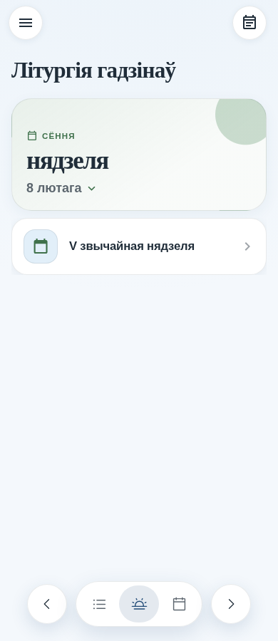 | 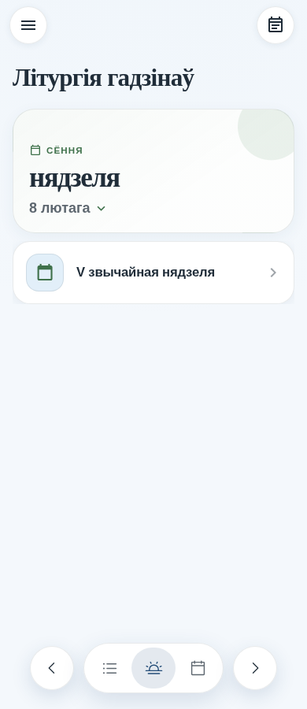 |
| Ютрань — начало | 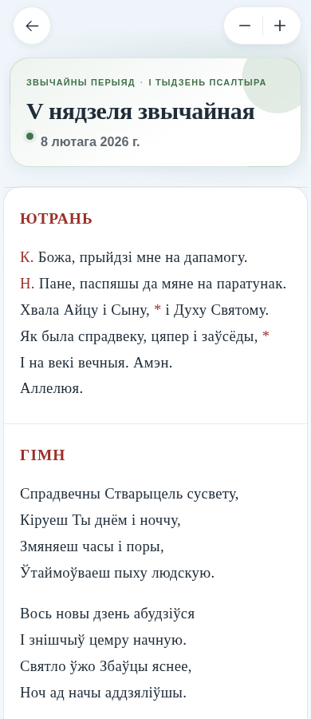 | 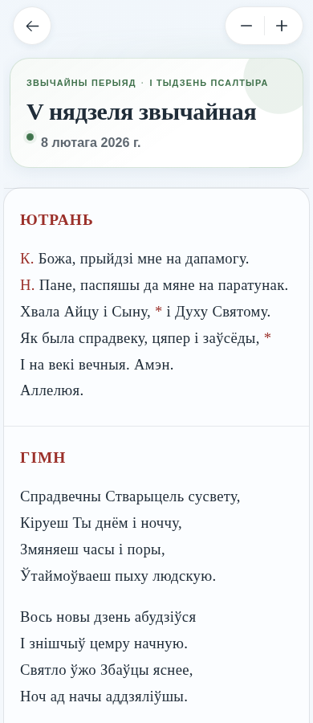 |
| Ютрань — середина | 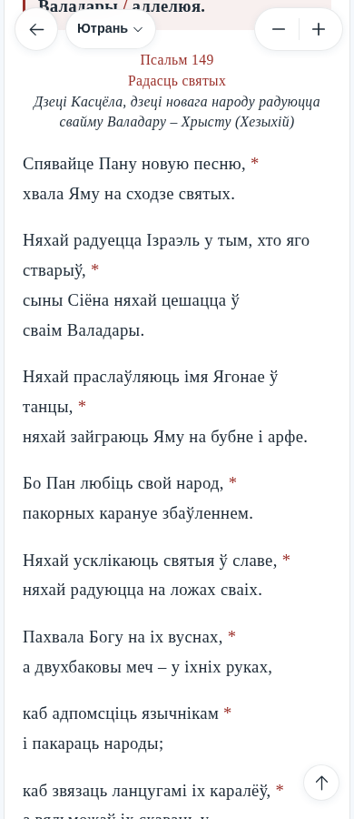 | 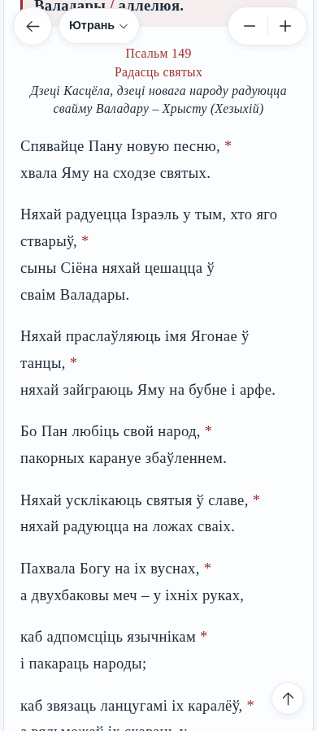 |
| Налады | 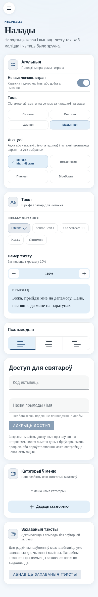 | 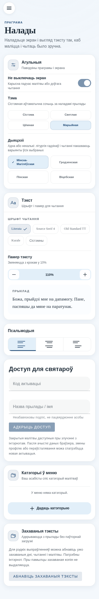 |
| Календарь | 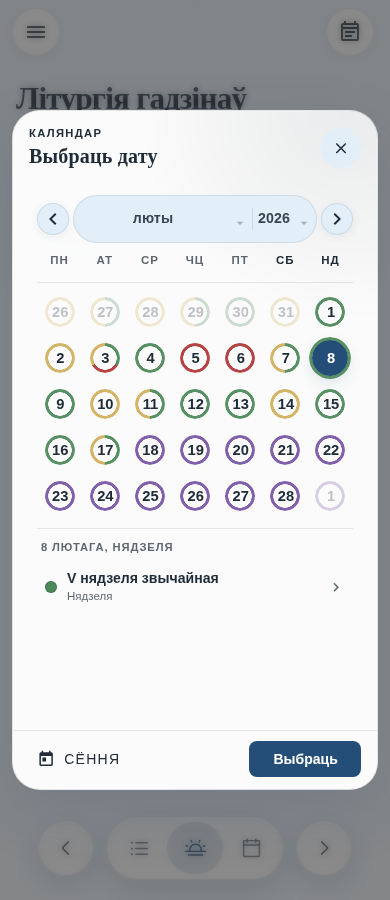 |  |

## 1440 px — до / после

| Экран | До | После |
| --- | --- | --- |
| Главная | 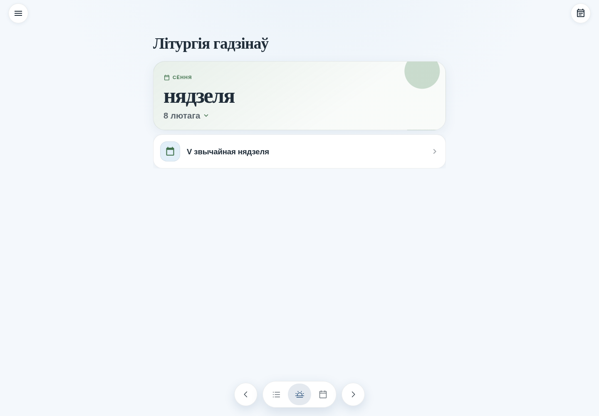 | 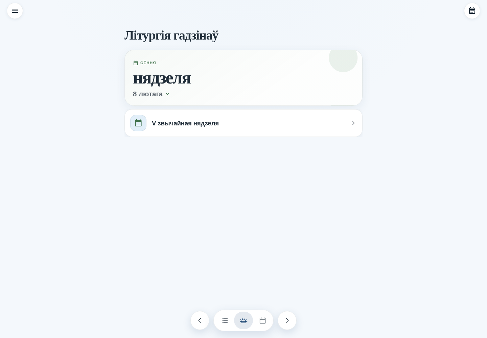 |
| Ютрань — начало | 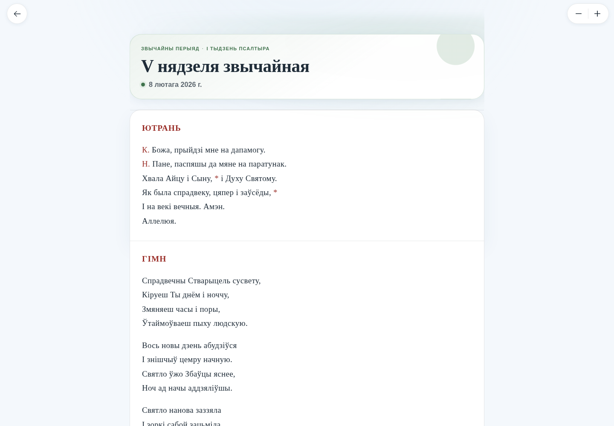 | 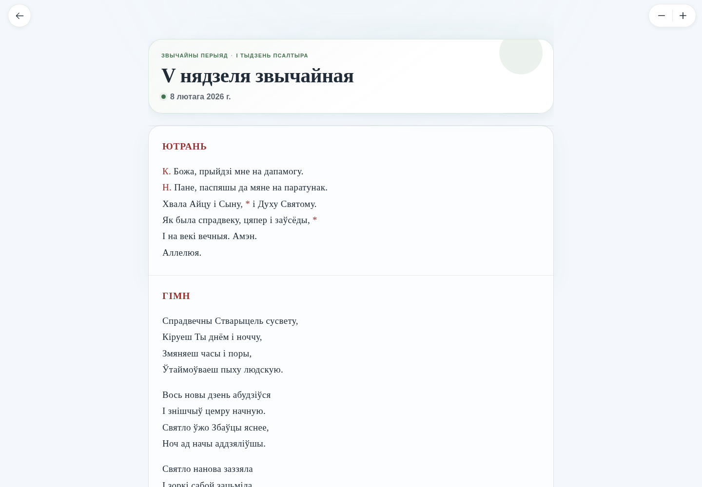 |
| Ютрань — середина | 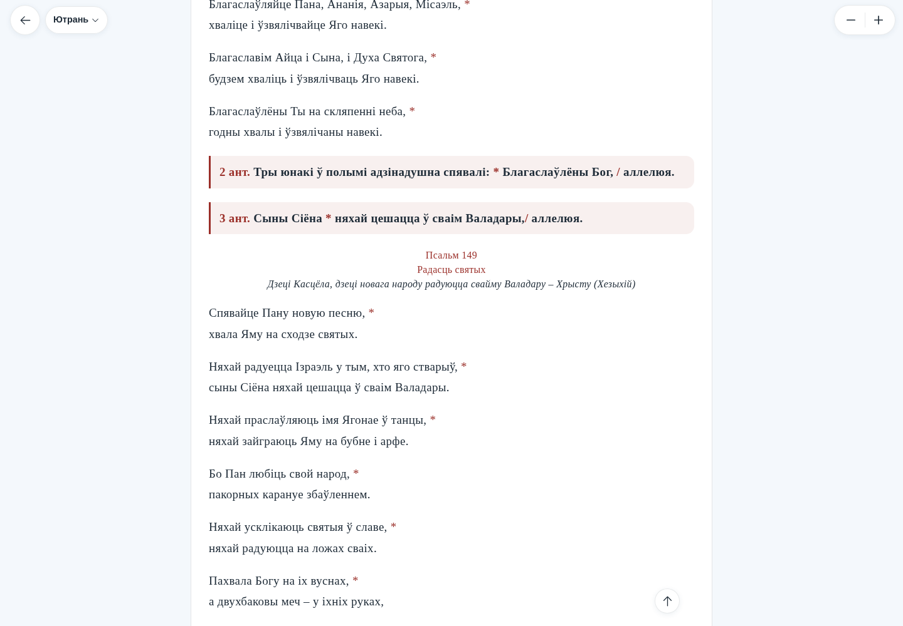 | 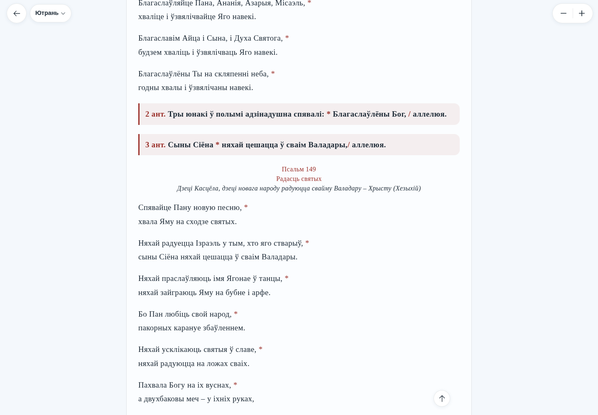 |
| Налады | 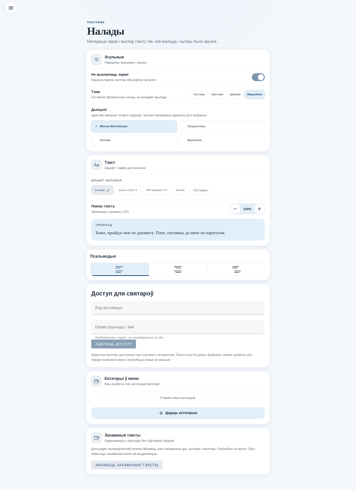 | 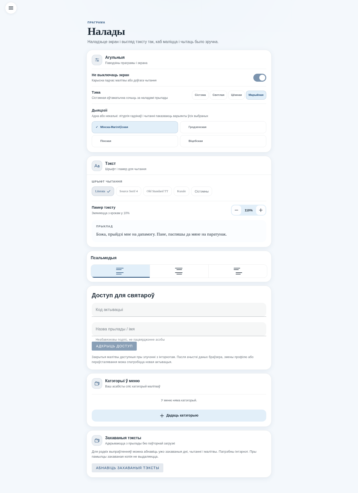 |
| Календарь | 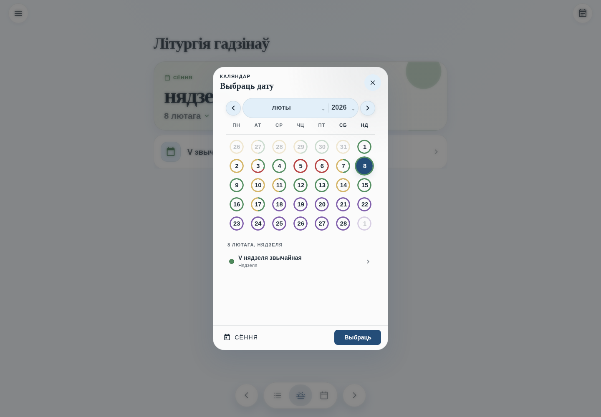 | 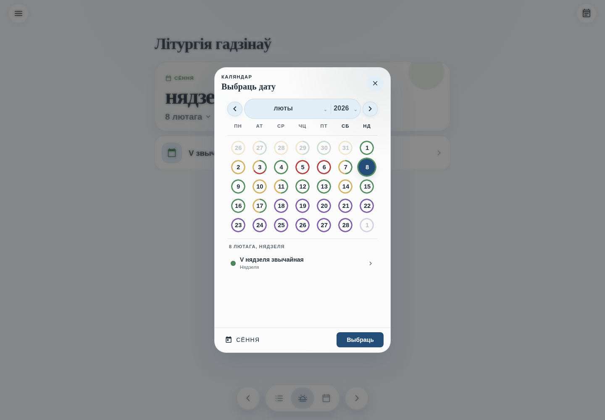 |

Вариант hero в списке часов также проверен:
[390 до](marian-theme/audit/before/390-marian-hours.png) /
[после](marian-theme/audit/after/390-marian-hours.png),
[1440 до](marian-theme/audit/before/1440-marian-hours.png) /
[после](marian-theme/audit/after/1440-marian-hours.png).

На середине длинного текста сохраняются тот же ритм, ширина строк и красные
рубрики; фон ровный и не меняет оттенок вдоль страницы.

Ограничения прежние: Chromium без физической установки PWA, внешние шрифты
недоступны в тесте, сборщик предупреждает о крупных чанках.
Merge и deploy не выполнялись; обновляется существующий Draft PR #191.
