# Марыйная тема MyBrev Web

Добавлена третья палитра `marian` и четвёртый вариант настройки «Марыйная».
Выбор применяется сразу, сохраняется в `themePreference`, восстанавливается после
перезагрузки и не следует за ОС. «Сістэма», «Светлая» и «Цёмная» сохраняют своё поведение.

## Архитектура и результаты исследования

- `src/constants/appearance.js` — единый источник палитр и цвета статус-бара;
  здесь же общий список четырёх вариантов, валидация, восстановление и разрешение
  системной настройки. Vuetify регистрирует `marian` с `dark: false`.
- Pinia `settings` выбирает тему Vuetify, сохраняет настройку и синхронизирует
  `html[data-appearance]`, legacy-ключ `theme` и `meta[name="theme-color"]`.
  Сохранённая настройка имеет приоритет; прежние явные `theme=light/dark`
  мигрируют в явные предпочтения. Неизвестное значение использует корректный
  legacy-выбор либо систему. Остальные пользовательские настройки не меняются.
- `main.scss` связывает существующие `--chrome-*`, `--nav-*`, `--reader-*`,
  `--rubric-*`, `--calendar-*` и ambient-переменные с Vuetify. Селектор общей
  группы теперь включает `marian`, поэтому переменные работают и в вынесенных
  в overlay-контейнер меню, диалогах, нижних панелях и уведомлениях.
- Новые значения материалов используют те же токены. Поверхность чтения белая,
  внешний фон почти белый, с мягким голубым оттенком. Геометрия экранов и тексты
  приложения не менялись; переключатели допускают четыре варианта. На телефоне
  используется компактное расположение 2×2 в настройках и панели чтения.
- `index.html` и `public/404.html` устанавливают сохранённый цвет до загрузки Vue.
  Марыйная использует `#244D78` для theme-color и `#F4F8FC` для document canvas;
  native controls используют светлый `color-scheme` даже при тёмной ОС.
- Найденные отдельные dark-селекторы в документах и Ordo корректируют только
  контраст документарных пометок и обводок цветовых точек. Марыйная использует
  исходный светлый вариант. Эти селекторы не требуют изменений.
- Литургические палитры `liturgical.js`, цвета периодов/облачений, красные
  рубрики, документарная магента, красные избранные элементы и четыре цвета
  выделения Бібліі сохраняют своё значение. Приложение не связывает тему
  `marian` с выбором литургического периода или праздника.

Палитры `light/dark`, их отдельные CSS-блоки и общие определения токенов
дополнительно сравнены с `main` (`e30f163`): значения не изменены.
Параллельной системы оформления нет.

## Изменённые файлы

| Файл | Изменение |
| --- | --- |
| `src/constants/appearance.js` | Марыйная палитра, функциональные цвета, общие варианты и восстановление |
| `src/plugins/vuetify.js` | Регистрация темы |
| `src/stores/settings.js` | Поддержка нового сохранённого предпочтения через общие функции |
| `src/styles/main.scss` | Подключение темы к существующим токенам и белая поверхность чтения |
| `src/views/Settings.vue` | Четыре пункта и мобильная компоновка |
| `src/components/TextSettingsSheet.vue` | Тот же список в панели чтения; отсутствие перекрытия заголовка и кнопок |
| `index.html`, `public/404.html` | Первое отображение, canvas, theme-color, color-scheme |
| `tests/appearance.test.mjs` | Палитра, контраст, регистрация, 120 комбинаций первого отображения, настройки и миграция |
| `scripts/smoke-appearance.mjs` | Регрессии в Chromium на реальной production-сборке, локальные presentation-данные |
| `scripts/smoke-appearance-bible.mjs` | Настоящий экран Бібліі с локальным набором текста вместо сетевого сервиса |
| `scripts/smoke-ui.mjs` | Актуальное доступное имя «Сістэма» |
| `package.json` | Команда `smoke:appearance` |
| `docs/marian-theme.md`, `docs/marian-theme/` | Этот отчёт, результаты и скриншоты |

## Проверки

- `npm run lint` — успешно.
- `npm test` — 1092 теста: **1081 успешно, 11 skipped, 0 ошибок**.
- `npm run build` — успешно, включая генерацию PWA service worker.
- `git diff --check` — успешно.
- Production preview + `npm run smoke:appearance` — **21 сценарий**, без ошибок
  JavaScript, горизонтального overflow и обрезанных подписей.
- `node scripts/smoke-appearance-bible.mjs` — **6 сценариев** на реальном экране
  Бібліі с локальным публичным набором текста.

Основной браузерный прогон: Chromium, ширины **320, 390, 1440 px**, все три палитры.
Оба переключателя проверяют четыре варианта; тесты меняют `prefers-color-scheme`,
перезагружают страницу, проверяют сохранение и восстановление выбора, canvas,
статус-бар, legacy API, миграцию `theme=light/dark`, сохранность масштаба и избранного.
Проверяются диалог, панель чтения, календарь, меню навигации, уведомления; отдельно
Марыйная проходит через чытанні, малітвы, список и чтение спеваў, Ordo и Біблію.
Дополнительный прогон Бібліі загружает главу, открывает выбор книги и подтверждает,
что amber/rose/sky/leaf выделения не перекрашены, во всех трёх темах, на 390/1440 px.

Данные проверки хранятся только в локальных тестовых контекстах. Все внешние
запросы заблокированы; production Firestore не читается и не изменяется.
Для скриншотов основной прогон фиксирует дату 08.02.2026 и масштаб текста 110%.
Снимки главной и настроек полные; чтение показывает первый экран длинного текста.
Визуально просмотрены основные экраны, светлые сравнения и мобильная панель.

Результаты: [production](marian-theme/results-production.json),
[Біблія](marian-theme/results-bible.json).

### WCAG AA

Автоматически вычисляется относительная яркость sRGB и contrast ratio.
Для текста требуется ≥4,5:1; для фокусной обводки ≥3:1.
Проверяются `background`, `surface`, `surface-variant` во всех палитрах.
Для новой темы проверяются также error/success/warning/info и их on-цвета.

| Цвет текста | На белом `surface` | Минимум на трёх поверхностях |
| --- | ---: | ---: |
| Основной `on-surface` | 14,04:1 | 12,00:1 |
| Вспомогательный `on-surface-variant` / `reader-muted` | 5,80:1 | 4,96:1 |
| `primary` / `devotional` | 8,72:1 | 7,45:1 |
| `rubric` | 7,37:1 | 6,30:1 |
| `error` | 6,90:1 | 5,90:1 |
| `success` | 6,93:1 | 5,92:1 |
| `warning` | 6,54:1 | 5,59:1 |
| `info` | 6,81:1 | 5,82:1 |

Заданный `secondary #477DAA` сохранён. Белый текст на нём дал бы только 4,39:1,
поэтому `on-secondary` тёмный (4,78:1). Для мелкого secondary-текста используется
имеющийся `primary`, только внутри Марыйнай темы. `ambient` — декоративный тон,
он не используется как текст или единственный функциональный индикатор.

## Сравнение основных экранов

В каждой строке слева Марыйная, справа Светлая. Изображения открываются в полном размере.

### Телефон: 390 px

| Экран | Марыйная | Светлая |
| --- | --- | --- |
| Главная | 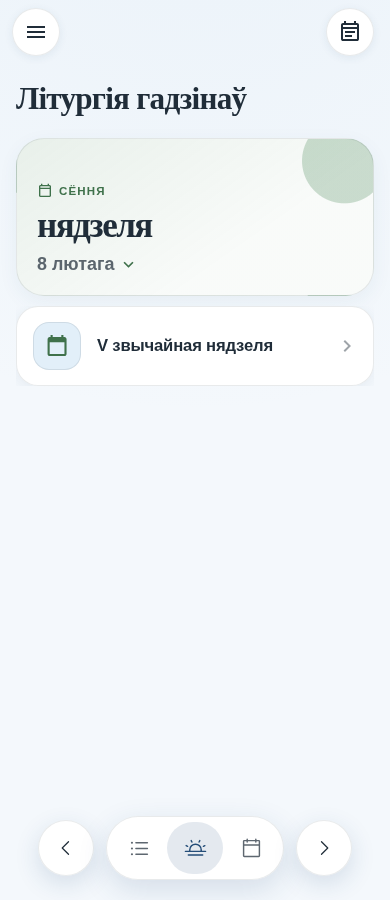 | 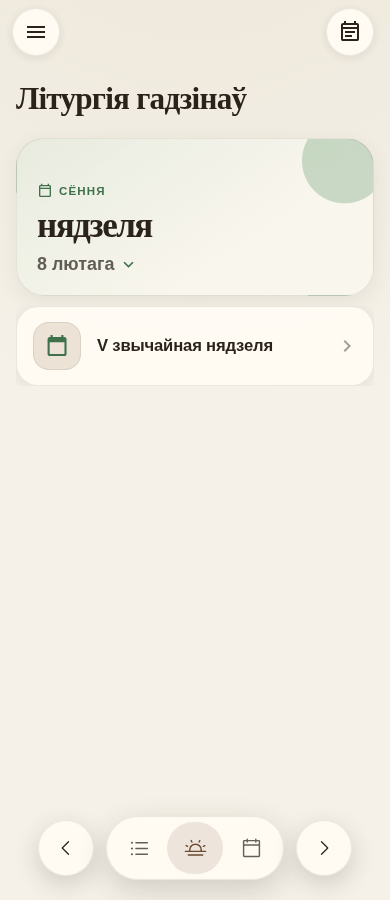 |
| Чтение | 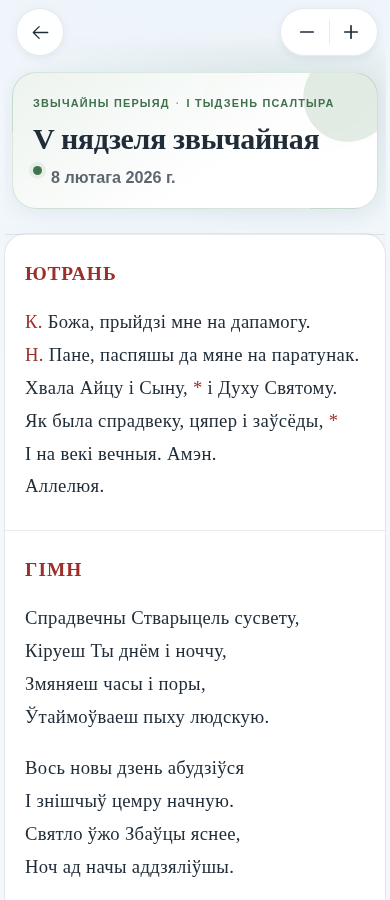 | 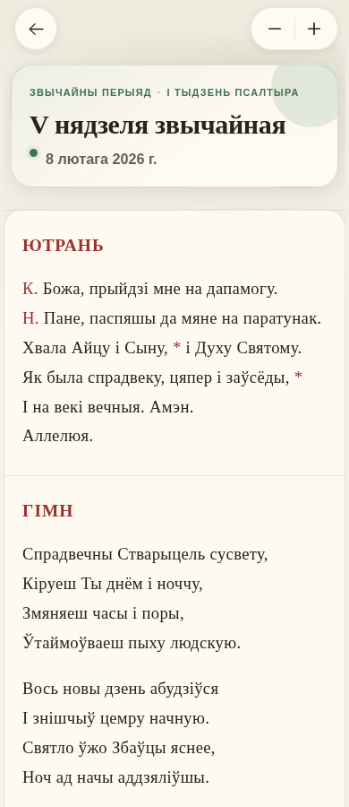 |
| Налады | 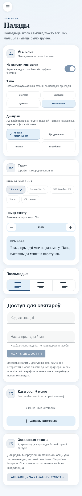 | 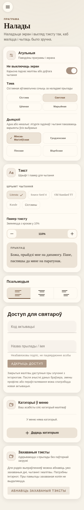 |

### Десктоп: 1440 px

| Экран | Марыйная | Светлая |
| --- | --- | --- |
| Главная | 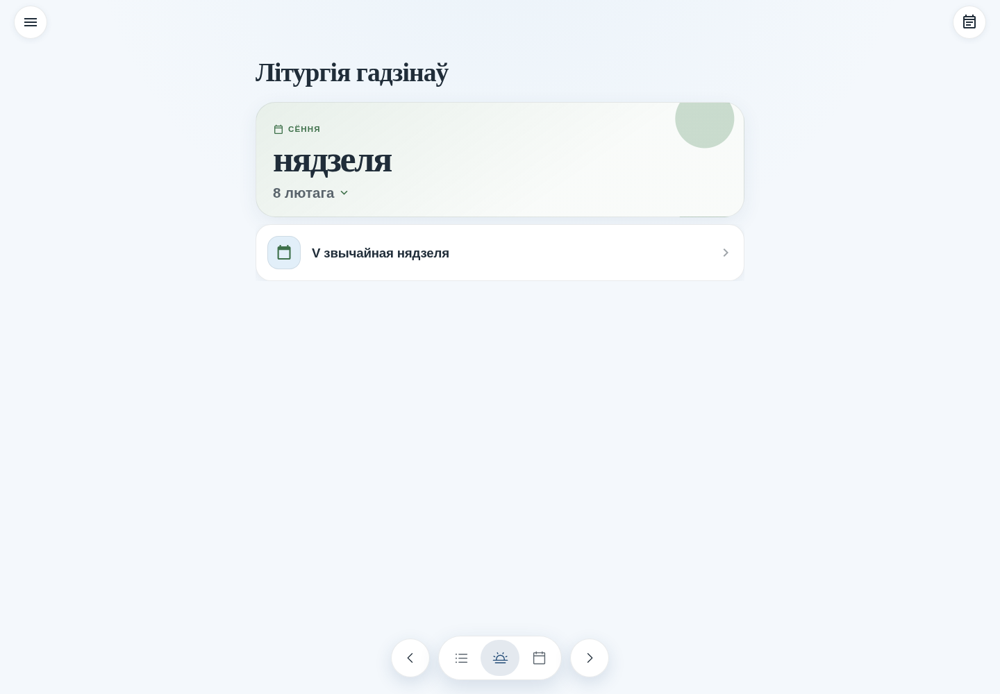 | 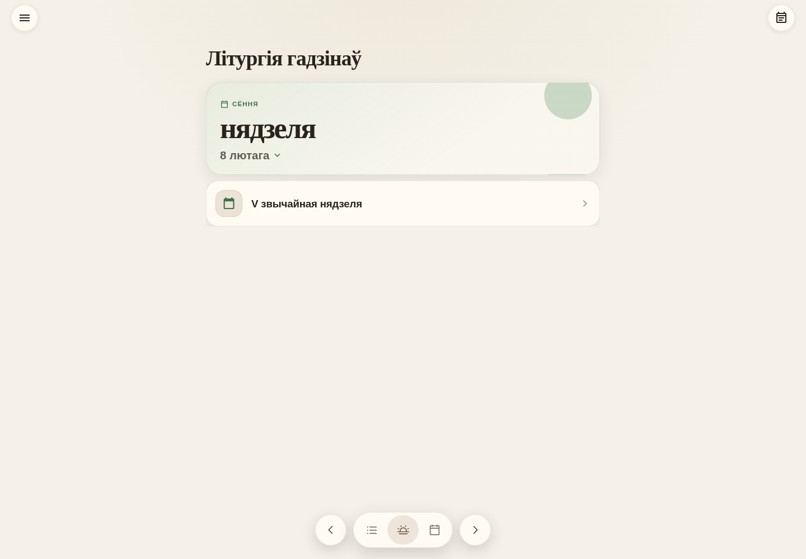 |
| Чтение | 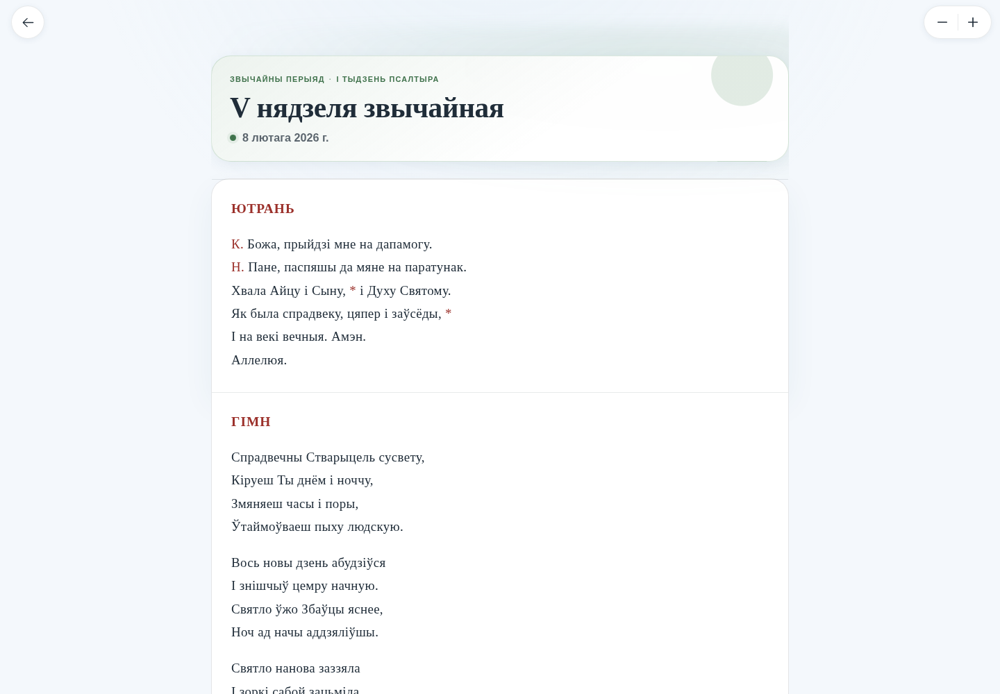 | 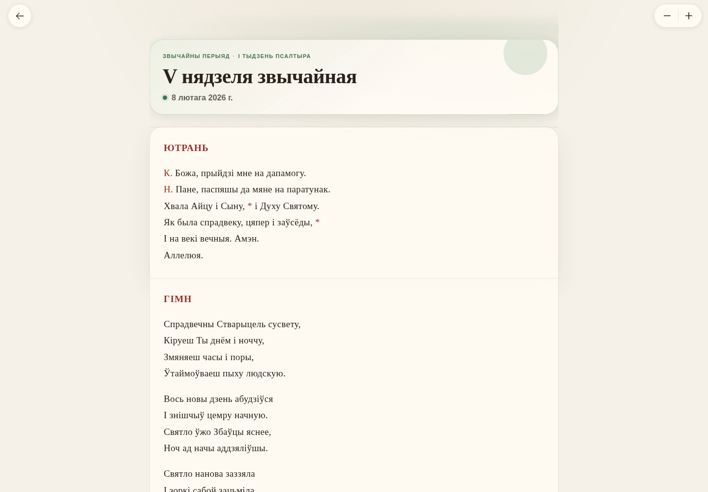 |
| Налады | 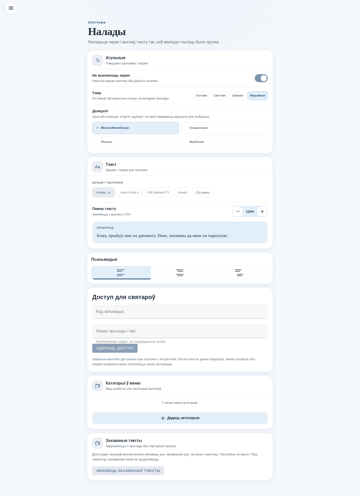 | 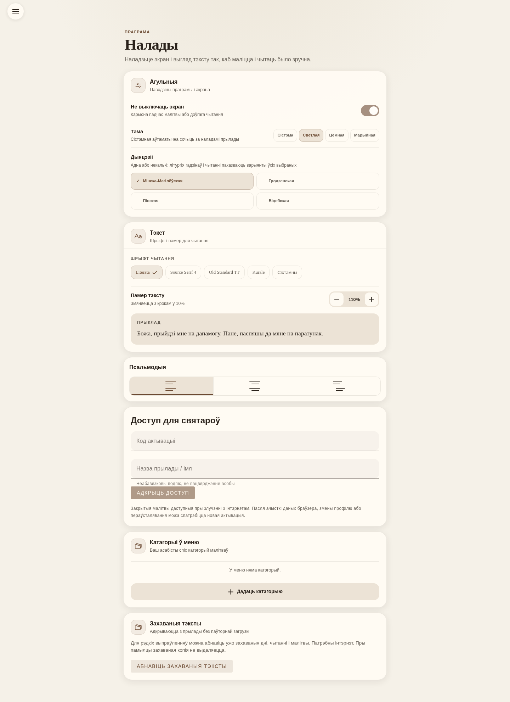 |

Дополнительно: [панель чтения на 320 px](marian-theme/320-marian-text-settings.png),
[диалог](marian-theme/390-marian-dialog.png), [календарь](marian-theme/390-marian-calendar.png),
[Біблія с текстом](marian-theme/390-marian-bible.png).

## Оставшиеся замечания и границы проверки

Функциональных ошибок темы в выполненных проверках не осталось.

- Сборщик предупреждает о крупных чанках. Изменение разбиения бандлов не относится
  к теме и не выполнялось.
- Проверки выполнены в Chromium, без физической установки PWA на Android/iOS.
  Цвет статус-бара проверен через meta-тег и canvas; управление реальной системной
  панелью остаётся за браузером/ОС.
- PWA splash screen использует статическую исходную светлую палитру манифеста.
  Сохранённая тема документа и theme-color применяются до запуска Vue.
- Внешние Google Fonts заблокированы вместе с остальными внешними сервисами,
  поэтому скриншоты показывают штатные fallback-шрифты приложения.

Merge, Firebase deploy, публикация содержимого и изменения других PR не выполнялись.

## Повторение проверок

```sh
npm run lint
npm test
npm run build
npm run preview -- --host 127.0.0.1 --port 4175
# В другом терминале, с теми же VITE_* переменными, что и при сборке:
SMOKE_BASE_URL=http://127.0.0.1:4175 npm run smoke:appearance
node scripts/smoke-appearance-bible.mjs
```

Для браузеров вне Linux задайте `BENCHMARK_BROWSER_PATH`.
Результаты и полные дополнительные снимки записываются в игнорируемый `outputs/`.
